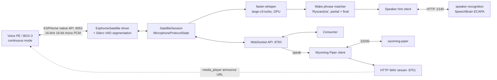

# piotr_voice_hub: design doc (rev. 3)

> **Status:** Rev. 3, after Maciej's second review. Repo bootstrap (T-001) is merged; P0 (§11) is next.
> **Repo:** <https://github.com/maciekgajewski/piotr_voice_hub> (public, MIT). Work is tracked per task in `docs/tasks/`.
> **Source:** all needed code, config and docs are **copied** from `maciekgajewski/piotr_the_ai_server` @ `a299643`. Paths below refer to that repo.

## Project rule: SIMPLICITY, NARROW SCOPE, RELIABILITY

This is the first rule in the new repo's `AGENTS.md`, above everything else:

> **SIMPLICITY, NARROW SCOPE, RELIABILITY.** The hub is a voice I/O engine and nothing more. Prefer the smallest mechanism that works. Do not add features, options or integrations that are not in this document. Every change must keep the hub running unattended for weeks: bounded queues, timeouts on every wait, supervised reconnects, fail loudly in logs.

## 1. Scope

**What it is.** A service that owns the configured ESPHome satellites (Home Assistant Voice PE boxes, ESP32-S3-BOX-3) **entirely, down to the firmware**, in continuous-listening mode. The firmware lives in this repo, the hub is the satellites' only ESPHome API client, and Home Assistant never touches them. It does four things:
1. Detects speech with a neural VAD.
2. Transcribes it with Whisper on the GPU.
3. Accepts utterances addressed with the single wake phrase **"Ryszardzie"** and attaches a speaker hint.
4. Speaks text (Piper) or plays audio back on a satellite when asked.

It exposes **one simple WebSocket API** to whatever consumer connects.

**In scope:**
- Satellite audio ingest.
- VAD and wake-phrase matching.
- Polish STT.
- Speaker hint.
- TTS and playback.
- A follow-up listen requested by the consumer.
- The satellite firmware needed for continuous mode.

**Not in scope:**
- Agents, LLMs, routing or adapters of any kind. Consumers are someone else's problem.
- Home Assistant, in any role, on the satellites.
- Authentication: security is external (LAN or Tailscale).
- Languages other than Polish.
- Barge-in.
- Hub-side conversation policy.

## 2. Why build

The closest off-the-shelf stack is HA Assist plus Wyoming (`wyoming-faster-whisper`, `wyoming-piper`), [wyoming-voice-match](https://github.com/jxlarrea/wyoming-voice-match) and [Webhook Conversation](https://github.com/eulemitkeule/webhook-conversation). It has three problems:
- It requires stock firmware.
- It keeps HA in the audio path.
- It does not hand speaker identity to the consumer.

Piotr already has a hardware-tested continuous-mode driver, STT and speaker recognition. The hub reuses those, plus `wyoming-piper` as the TTS backend.

## 3. Hardware (verified on `piotr`, 2026-10-18)

| Item | Finding |
|---|---|
| OS | Ubuntu 26.04.1 LTS |
| CPU | AMD Ryzen 5 5600, 6 cores / 12 threads. **AVX, AVX2 and FMA present** |
| RAM | 60 GiB |
| GPU | NVIDIA GeForce RTX 5060 Ti, **16 GB VRAM** (12 MiB used at check time), compute capability 12.0 (Blackwell) |
| Driver / CUDA | Driver 595.99.02, CUDA 13.2 (driver API) |
| GPU sharing | Ollama keeps running on this host for unrelated tasks. It is not part of this project, but it shares the GPU with the hub |
| Docker | Docker 29.1.3. The `nvidia` runtime is in `/etc/docker/daemon.json`, a CDI spec is at `/var/run/cdi/nvidia.yaml`, and `nvidia-ctk` is installed. The user `grok-developer` is in the `docker` group; `docker info` lists runtimes `nvidia` and `runc` (default `runc`) and CDI devices `nvidia.com/gpu=all` |

Consequences:
- The old repo's "i7-930 without AVX" note and its community no-AVX TensorFlow wheel (`wakeword/README.md`, `third_party/tensorflow-wheels/`) are **stale for this host**. Neither is carried over.
- Blackwell needs CUDA ≥ 12.8 user-space builds. The old images already use `nvidia/cuda:12.8.1-cudnn-runtime-ubuntu24.04`.
- **Verified 2026-10-18:** faster-whisper 1.2.1 / CTranslate2 4.8.3 with cuBLAS 12.9 and cuDNN 9 runs on this GPU (in a scratch venv on the host, outside Docker; see §4.3). **Confirmed in the container (T-003):** the same stack works in the `cuda:12.8.1-cudnn-runtime-ubuntu24.04` image, and the onnxruntime-gpu 1.26.0 CUDA EP (Piper) works on sm_120. onnxruntime-gpu 1.28+ are CUDA 13 builds and silently fall back to CPU on this image, so pin 1.26.0.

## 4. Architecture



### 4.1 Pipeline per satellite
1. **Arm.** On connect, the hub sets the `IDLE` visual and calls the `start_open_mic_listening` service. The firmware runs `voice_assistant.start_continuous`. This is the only listening mode.
2. **Segment with Silero VAD.** It replaces the peak-loudness gate (`_observe_audio_level`, `speech_peak_threshold` in `drivers/box3_esphome.py`). The peak gate needed calibrating per device (`tools/mic-silence-calibrate.sh`), fired on TV and clatter, and fed Whisper non-speech, which is where Whisper hallucinates. Silero is small, runs on the CPU per 32 ms frame, and needs no tuning per device, so this is a reliability win.
   - Keep it simple: one ONNX model on onnxruntime CPU (already a faster-whisper dependency), one recurrent state per satellite.
   - Fixed hysteresis: start when p ≥ 0.5 for 250 ms; end after 0.8 s with p < 0.35.
   - Keep the existing 1 s pre-roll ring buffer and a 15 s maximum segment length.
   - The driver still emits `SpeechStarted`/`AudioChunk`/`SpeechEnded`. Only the detector changes.
3. **STT.** Each segment streams into a `FasterWhisperStreamingSttSession`, which gives partials every 0.75 s and a final transcript at segment end, language fixed to `pl`.
4. **Wake phrase.**
   - Normalize each word: lowercase, strip diacritics (ł folded explicitly).
   - Match only the vocative `ryszardzie` as a whole word within the first three words; repeats right after it are skipped. Other case forms (Ryszard, Ryszarda, Ryszardem…) don't wake: TV and radio talk *about* a Ryszard, people address the hub in the vocative. Revisit at hardware acceptance if Whisper drops the vocative ending.
   - **On a partial match:** emit `wake`, set the `LISTENING` visual (wake candidate).
   - **On the final:** if the phrase is confirmed and the remaining text is non-empty, accept. Otherwise emit `wake_cancelled`, call `reset_open_mic_wake_candidate`, set `IDLE`, and keep listening.
   - This is today's `_capture_open_mic_utterance` / `_text_after_wake_phrase` logic, made tolerant to punctuation, case and diacritics.
5. **Accept.**
   - Stop listening and play the `accepted` cue.
   - Set the `PROCESSING` visual.
   - Run speaker recognition on the segment audio.
   - Emit `transcript_final` (text after the phrase, plus the speaker hint).
   - The satellite stays `PROCESSING` until the consumer sends `speak`/`play`/`release`, or `reply_timeout` (30 s) expires. On timeout, play the timeout cue and re-arm.
6. **Speak/play.**
   - Piper synthesizes over Wyoming. One shared HTTP server streams `/<playback_id>.wav`.
   - The hub sends `media_player_command(media_url, announcement=True)`, as today in `_start_playback`. `play` passes a consumer URL straight to the media player.
   - `playback_finished` fires when the stream drains. Then the hub re-arms continuous listening.
7. **Follow-up.** If the command had `listen_after: true`:
   - After playback, while the satellite is still disarmed, the hub sets `LISTENING`, plays the `follow_up_ready` cue, and then re-arms continuous listening (cues play only while disarmed, MP-AUDIO-001).
   - The **next VAD segment within `follow_up_seconds` (default 8 s) after re-arming is accepted without the wake phrase.**
   - If no speech starts before the deadline, the hub stops listening, plays the `timeout` cue, sets `IDLE` and re-arms.
   - That is the whole mechanism. The hub keeps no conversation state beyond this one flag.
8. **Announcements.** `speak` to an idle satellite (listening, no speech segment open) stops listening, plays, then re-arms. Otherwise the busy policy (§6) applies.

### 4.2 STT model choice: `large-v3-turbo`, float16
The hub shares the GPU with Ollama (§4.3), but the measured footprint of `large-v3-turbo` is small enough to afford it.
- **large-v3-turbo** (809M parameters, 4 decoder layers) keeps the large-v3 encoder, so it gives near-large-v3 accuracy on Polish. Decoding is several times faster than large-v3 (32 decoder layers). That matters because partials re-transcribe a 4 s window every 0.75 s for each active satellite.
- It needs about 2.1 GB loaded and 2.3 GB peak of the 16 GB VRAM, CUDA context included (measured, §4.3).
- **Fallback:** `medium` with `compute_type: int8_float16` (measured 1.1 GB) if VRAM gets tight next to Ollama, or if latency is ever an issue. `large-v3` is not worth roughly 3× the decode time for this use.
- Load and warm it at startup (existing `FasterWhisperSpeechToText.start`).
- Use beam 5 for finals and beam 1 for partials.

### 4.3 VRAM budget (shared GPU)
| Component | VRAM | Basis |
|---|---|---|
| faster-whisper `large-v3-turbo` float16 | **2.1 GB loaded, 2.3 GB peak** (beam 1 and 5, one stream; CUDA context included) | **Measured** in the hub's CUDA 12.8 container, T-003 (2085 / 2289 MiB over an idle GPU). A host-venv run with per-process `nvidia-smi` gave 2.1 / 2.2 GB |
| faster-whisper `medium` int8_float16 (fallback) | **1.06 GB loaded, 1.13 GB peak** | **Measured** on the host (per-process `nvidia-smi`); not re-measured in the container |
| Concurrent partials from several satellites | about +0.3–0.5 GB | Estimate. One shared model; extra activation buffers per in-flight decode |
| Piper `pl_PL-bass-high` on CUDA (wyoming-piper) | **0.3 GB loaded, 1.2 GB peak** | **Measured**, T-003: onnxruntime-gpu 1.26.0, the real voice model, 400 random phoneme ids (about 11 s of audio). The first inference took 48 s (cuDNN algorithm search) and later ones 0.1 s, so Piper needs a warm-up at startup |
| ECAPA speaker recognition | **0 GB** (CPU) | Decision: keep today's `--device cpu` default. ECAPA is about 20M parameters, so a few seconds of audio embed quickly on the Ryzen 5 5600. On CUDA it would cost about 0.4–0.7 GB, mostly CUDA context (estimate) |
| **Hub total** | **about 4 GB** (3.8–4.0 GB: hub process 2.6–2.8 GB with partials, plus Piper 1.2 GB) | The driver also reserves 0.46 GB of the device. That leaves about 11.8 GB for Ollama when it runs |

- **Measurement method:** `tools/gpu-smoke.sh` (T-003). Load the model, transcribe a 2.1 s Polish clip from `audio/monitor-test/`, and sample device memory with NVML (v2 `used`, which excludes the driver reserve) on an otherwise idle GPU.
- **First-call latency:** the first transcription took 7.8 s; later calls took 0.17–0.21 s with beam 5. The startup warm-up is therefore mandatory.
- **Rule:** the hub loads its models at startup and holds them. If Ollama ever pushes the GPU into out-of-memory, the hub fails loudly and Docker restarts it; the configured fix is the `medium`/int8 fallback, not dynamic unloading.

## 5. Components: copy, adapt, rewrite

Proposed package layout in `piotr_voice_hub/`:
- `satellites/`: messages, protocol, interfaces, `esphome.py`, `vad.py`
- `stt/`
- `speaker/`
- `tts/`
- `hub/`: session, wake, api, playback HTTP
- `config.py`

| Module | Source path | Action | Notes |
|---|---|---|---|
| Driver messages | `ai_server/microphones/messages.py` | Copy, trim | Keep only the `OPEN_MIC` mode. Remove the `WAKE_WORD`/`FOLLOW_UP` modes. |
| Protocol state machine | `ai_server/microphones/protocol.py` | Copy, trim | Keep the MP-* invariants and asserts; drop the per-mode branches. |
| Interfaces/types | `ai_server/microphones/interfaces.py`, `types.py` | Copy | Drop `TextToSpeech.speak()`. |
| ESPHome driver | `ai_server/microphones/drivers/box3_esphome.py` | Copy, adapt | Swap the peak gate for Silero. Delete wake-word/follow-up service paths. Make the playback HTTP server shared. Keep the T-002/T-003/T-010 fixes (pre-roll bound, stop ack, transport recovery). |
| VAD | new | Write | About 80 lines: Silero ONNX wrapper with hysteresis. |
| STT | `ai_server/speech_to_text/*` | Copy | Replace the `ai_server.config.SttConfig` import. |
| Transcript fixes | `ai_server/speech_to_text/transcript_preprocessor.py`, `utils/polish_numbers.py`, `utils/text.py` | Copy | Only what the preprocessor uses. |
| Speaker recognition | `ai_server/speaker_recognition/*` | Copy | Service unchanged (:2140). In the client, drop the `microphones.messages` import. |
| TTS | `ai_server/microphones/tts.py` | Copy `PiperTextToSpeech.synthesize` only | Delete `_stream_to_box` (duplicate playback path). |
| Session | `ai_server/microphones/manager.py` | Rewrite (about 400 lines) | Take the logic of `_capture_open_mic_utterance`, `_wait_for_speech_start`, `_set_visual_state`, `_play_cue`, `_recover_microphone_boundary` and the per-satellite supervision loop. No `Agent`, no conversations bridge, no processing cues. |
| Wake matcher | `manager._text_after_wake_phrase`, `_collect_open_mic_partials` | Rewrite (small) | Normalized stem match on partial and final. |
| API server | new (pattern from `ai_server/websocket_server.py`) | Write | aiohttp WebSocket, broadcast events, bounded per-client queue. |
| Config | `ai_server/config.py` | Rewrite (small) | Hub dataclasses only. A config path is required; CLI options override config values (rules carried from `AGENTS.md`). |
| Not copied | `conversations/`, `orchestrator/`, `agent*/`, `domain_agents/`, `ai_tools/`, `home_assistant/`, `ollama_*`, `websocket_client/`, `custom_components/`, `openclaw_voice/`, `wakeword/`, wake-word tools | — | Out of scope. |
| Tools | `tools/lib/mic_protocol_test.py`, `capture_voice_samples.py`, `box3_api_probe.py`, `tools/speaker-profile-build.sh` | Copy | Driver probing and voice-profile enrolment. |
| Docs | `docs/microphone-protocol.md`, `docs/project-standard-satellite-behavior.md`, `docs/home-assistant-voice-pe-bedroom-setup.md`, `docs/protocol-documentation-standard.md`, `AGENTS.md` (Python/logging/error rules) | Copy, trim | Remove wake-word/follow-up modes and conversation-mapping references. |

## 6. API (WebSocket JSON, no auth)

**Endpoint:** `ws://<host>:8750/ws`. Every connected client receives every event, and any client may send commands. `GET /healthz` returns satellite states.

**Envelope:**
```json
{"type": "transcript_final", "satellite": "voice-pe-bedroom", "ts": "2026-10-18T16:40:12.120Z", "data": {}}
```
- Commands carry a client `id`. The hub replies `ack` or `error` with `reply_to`.
- Hub-generated `utterance_id`/`playback_id` are never reused.

### Events (hub → consumer)
| Type | Data |
|---|---|
| `satellite` | `area`, `connected`, `state` (`idle/listening/processing/speaking/error`) |
| `wake` | `utterance_id` (fired on the first partial match) |
| `wake_cancelled` | `utterance_id` (final transcript did not confirm) |
| `transcript_partial` | `utterance_id`, `text` (post-phrase) |
| `transcript_final` | `utterance_id`, `text`, `raw_text`, `follow_up` (bool), `speaker` `{name, confidence}` or `null`, `audio_ms` |
| `playback_finished` | `playback_id`, `listening_for_follow_up` (bool) |
| `follow_up_timeout` | none |

### Commands (consumer → hub)
| Type | Data | Effect |
|---|---|---|
| `speak` | `text`, `listen_after?` (default false), `volume?` | Synthesize and play; `ack` carries `playback_id`. |
| `play` | `url`, `listen_after?` | Play a WAV/FLAC/MP3 URL the satellite can fetch. |
| `stop` | none | Stop current playback; re-arm. |
| `release` | none | End `PROCESSING` without speaking (e.g. nothing to say); re-arm. |

Errors are `busy`, `unknown_satellite`, `satellite_offline` and `bad_request`.

**Busy policy (decision).** `speak`/`play` is accepted when the satellite is listening with no open speech segment, or is waiting for a reply (`PROCESSING`). While a speech segment is being captured or audio is playing, it gets an immediate `busy` error. There is no queue; consumers send their next item after `playback_finished`. *Rationale:* no queue means no buffered audio and no stale state, so there is nothing to drain after a disconnect or restart.

```json
{"type":"transcript_final","satellite":"voice-pe-bedroom","ts":"2026-10-18T16:40:12.120Z",
 "data":{"utterance_id":"utt_42","text":"jaka będzie jutro pogoda","raw_text":"Ryszardzie, jaka będzie jutro pogoda?",
         "follow_up":false,"speaker":{"name":"Maciek","confidence":0.81},"audio_ms":2380}}
{"type":"speak","id":"c7","satellite":"voice-pe-bedroom","data":{"text":"Jutro dwanaście stopni i deszcz. Wziąć parasol?","listen_after":true}}
{"type":"ack","reply_to":"c7","satellite":"voice-pe-bedroom","data":{"playback_id":"pb_77"}}
{"type":"playback_finished","satellite":"voice-pe-bedroom","ts":"…","data":{"playback_id":"pb_77","listening_for_follow_up":true}}
```

The speaker is a **hint**: the top ECAPA match above the threshold, otherwise `null`.

## 7. Config

```yaml
log_level: INFO
api: {host: 0.0.0.0, port: 8750}
playback_http: {port: 8751}

satellites:
  defaults: {end_silence_seconds: 0.8, max_segment_seconds: 15, reply_timeout_seconds: 30, follow_up_seconds: 8}
  devices:
    - {id: voice-pe-bedroom, area: bedroom, address: piotr-voice-pe-bedroom-01.local, api_key: "…"}
    - {id: voice-pe-02,      area: living_room, address: piotr-voice-pe-02.local, api_key: "…"}
    - {id: voice-pe-03,      area: kitchen, address: piotr-voice-pe-03.local, api_key: "…"}
    - {id: box3-office,      area: office, address: piotr-box3-01.local, api_key: "…"}

wake_phrase: Ryszardzie

stt: {model: large-v3-turbo, device: cuda, compute_type: float16, beam_size: 5,
      partial: {interval_seconds: 0.75, window_seconds: 4.0, beam_size: 1}}

speaker_recognition:
  url: http://127.0.0.1:2140
  timeout_seconds: 1.0
  profiles: {Maciek: /profiles/maciek/profile/speaker_profile.npz}

tts: {uri: tcp://127.0.0.1:10200, voice: pl_PL-bass-high, volume: 1.0}
```

Language is not configurable: Polish is fixed.

## 8. Firmware

The firmware is part of this repo and is built and flashed from it. Copy `firmware/esphome/` and reduce it to continuous mode. Home Assistant is never adopted on these devices.
- **Keep:**
  - API encryption, the `voice_assistant` block with `start_continuous`, and the external media player (announce).
  - LEDs/display driven by server visual states, plus the firmware-owned `ERROR` state on disconnect.
  - The hardware mute switch and volume.
  - API services `start_open_mic_listening`, `stop_listening`, `reset_open_mic_wake_candidate`, `set_visual_idle/listening/processing`.
  - Cue services: accepted (`play_message_end_cue`), timeout (`play_conversation_timeout_cue`), and a new `play_follow_up_ready_cue` that reuses `sounds/follow_up_listening.wav`.
- **Remove:**
  - The `micro_wake_word` component and all models (`ryszardzie`, `okay_nabu`, `stop`), plus the wake-sensitivity select.
  - The on-device wake-word path, `start_follow_up_listening`, HA timers and the timer-ringing logic.
  - Cloud-auth error sounds.
- The absolute path `/home/maciek/piotr/wakeword/...` goes away together with the model.
- Keep `tests/test_microphone_firmware_conformance.py` and extend it to assert that no `micro_wake_word` remains.

## 9. Deployment

- **One compose file, three services**, all `network_mode: host` and `restart: unless-stopped`. Host networking lets satellites fetch the playback stream from the host IP, and Avahi/`libnss-mdns` resolves `.local` names.
  - `hub` (CUDA 12.8 base, GPU): from `docker/ai-server.Dockerfile`, with only the hub's dependencies. It uses CPU `onnxruntime` (Silero, via faster-whisper) and must never also install `onnxruntime-gpu`.
  - `wyoming-piper` (GPU, `--use-cuda`): from `docker-compose.yml`. **P1:** the image must install only `onnxruntime-gpu` (1.26.0), not `onnxruntime` too; the old `piotr-wyoming-piper` container has both, so it runs on CPU.
  - `speaker-recognition` (CPU): from `docker-compose.speaker-recognition.yml`, unchanged `--device cpu`.
- **Ollama coexists.** It keeps running on the host for unrelated tasks and is *not* in the hub's compose file. The two share the GPU within the budget in §4.3.
- **Ports:**

  | Port | Purpose |
  |---|---|
  | 8750 | API |
  | 8751 | Playback HTTP |
  | 2140 | Speaker recognition |
  | 10200 | Piper |
  | 6053 | Outbound to satellites |

  Bind API ports to the LAN or Tailscale interface as the external security boundary.
- **Exclusive ownership.** The hub is the only ESPHome API client of the configured satellites. Neither Piotr nor Home Assistant connects to them.
- **Reliability:**
  - One supervised task per satellite, with the existing reconnect and boundary recovery.
  - A timeout on every await (audio start/event timeouts carry over).
  - Bounded queues; a slow API client is disconnected rather than buffered.
  - STT warm-up before arming.
  - Process exit on invariant failure (the existing assert policy), so Docker restarts it.

## 10. Testing

- **Copy and adapt:**
  - `tests/test_box3_esphome_microphone.py` (mocked `aioesphomeapi`, recovery and pre-roll tests).
  - `tests/test_microphone_protocol.py`, `tests/microphone_driver_conformance.py`.
  - `tests/test_speech_to_text.py`, `tests/test_tts.py`, `tests/test_speaker_profile_builder.py`, `tests/test_transcript_preprocessor.py`, `tests/test_microphone_firmware_conformance.py`.
  - Delete the wake-word and follow-up mode cases.
- **New unit tests:**
  - VAD hysteresis (synthetic frames).
  - Wake matcher (vocative only, other case forms rejected, repeats, phrase late in the sentence, partial-then-cancel).
  - Session state machine with fake driver, STT and TTS (accept, cancel, reply timeout, follow-up window, busy, announcement while idle).
  - API schema and broadcast tests.
- **Recorded-audio fixtures:** WAVs captured from each satellite type (`capture_voice_samples.py`): phrase + command, inflected phrase, no phrase, TV/music, silence, two speakers.
  - Run them through VAD, STT and the matcher, and track false accepts and false rejects. Check the counts on the GPU before each release.
- **Soak test:** 72 h on all satellites with a TV on. Count false accepts, reconnects and stuck states.

## 11. Plan

| Phase | Work | Exit criteria |
|---|---|---|
| **P0** | Repo skeleton, `AGENTS.md` with the project rule, copied driver/protocol/STT, Silero VAD, session with wake matcher, API events, compose with hub only. sm_120 smoke test in the container. | A CLI client on the API prints `wake`/`transcript_final` from all four satellites; copied tests pass. |
| **P1** | Speaker-recognition and Piper services, `speak`/`play`/`stop`/`release`, announcements, `listen_after` follow-up. | Hardware: phrase → transcript with speaker → `speak` reply → follow-up answer without phrase. |
| **P2** | Firmware trimmed to continuous mode and reflashed; recorded-audio fixtures; soak test; docs. | Soak test passes; firmware conformance asserts no on-device wake word. |

## 12. Glossary

- **VAD (voice activity detection):** deciding, frame by frame, whether an audio stream contains human speech or just silence and noise. The hub uses it to cut the continuous satellite stream into speech segments, so Whisper only sees speech.
- **Silero VAD:** a small, free, pretrained neural network for VAD (about 2 MB). It returns a speech probability for each 32 ms of 16 kHz audio and is much more robust to TV, music and clatter than a loudness threshold.
- **ONNX:** a standard file format for trained neural networks. **onnxruntime** is the library that runs ONNX models on the CPU or GPU. Silero VAD and the Piper voices ship as ONNX files.

## Future (out of scope)
- Languages other than Polish.
- Barge-in / interrupting playback by voice.
- Additional or per-consumer wake phrases.
- Agent adapters (OpenClaw, webhooks, Ryszard) as separate consumer projects.
- API authentication.
